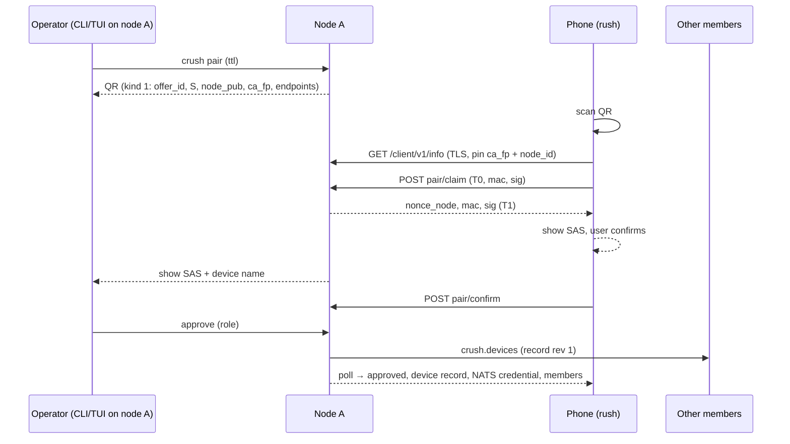

# Mobile Client Pairing — Design

Status: phase 1 in progress on branch `docs/mobile-qr-pairing`.

Implemented in phase 1 (see [Rollout](#rollout) for what is deferred):

- In-repo QR encoder (`internal/qr`) and terminal rendering.
- `rushpair1:` payloads, the v1 handshake (transcript, MAC, signatures, SAS), offers with expiry and single use.
- `crush pair`, `crush pair accept`, `crush pair list`, `crush pair revoke`, and the TUI `Pair Mobile Device` dialog.
- The `/client/v1` pairing endpoints and the `/v1/cluster/pairing` and `/v1/cluster/devices` local API.
- The device registry with scoped NATS credentials, replicated over the mesh, and cluster-wide revocation.

Implementation map: `internal/qr` (encoder), `internal/pairing` (payloads, crypto, offers, registry, device-side session), `internal/cluster/clients.go` (CLIENTS account, device NATS users, CA fingerprints), `internal/server/pairing.go` (client listener, local API, `crush.devices` replication), `internal/cmd/pair.go` (CLI), `internal/ui/dialog/pair_qr.go` (TUI).
Known-answer vectors for rush live in `internal/pairing/testdata/vectors.json`.

## Overview

This spec adds a **client device** trust class to the Crush cluster so a phone
running [rush](https://github.com/taigrr/rush) (React Native / Expo) can pair
once by QR code and then see and drive every session on every node.

A device pairs with one node, but the resulting device record is replicated to
every member, so the device can authenticate to any node, follow sessions as
they move, and keep working when the node it paired with is offline.
Revoking a device from any node revokes it everywhere.

The design reuses what the cluster already has (see [cluster.md](../cluster.md)):
approval-gated pairing, ID-and-key pinning, the embedded NATS mesh, the
`/v1/nodes/<node-id>/...` proxy, and the wire 2 event stream.

## Goals

- Pair a phone with the whole cluster from a single QR scan, in either
  direction:
  - **(a)** a node shows a QR code, the phone scans it;
  - **(b)** the phone shows a QR code, an operator approves it from any node.
- Every pairing is confirmed by a human on a node, using a short
  authentication string (SAS) shown on both screens.
- Mutual key pinning: the phone pins the cluster, the cluster pins the phone.
- One credential valid on every node; revocation propagates over the mesh.
- A primary transport that works well on mobile networks (NATS over TLS
  websocket) and a plain HTTPS fallback.
- Scoped permissions: a device can be read-only, an operator, or explicitly
  granted more; it never gets node-level powers by default.
- Optional push notifications for attention events that never carry code,
  prompts, or tool input.

## Non-goals

- Phones are **not** cluster members.
  They hold no cluster key, no member certificate, no replicas, and never own
  sessions or run jobs.
  They do not route NATS traffic and never see mesh-internal subjects
  (`crush.creds`, `crush.repl.*`, `crush.swarm.*`, `crush.heartbeat`).
- No credential sync to devices: API keys and OAuth tokens never leave the
  nodes.
- No relay / NAT traversal service in this spec.
  Devices reach nodes over LAN, WireGuard, or Tailscale.
  The typed endpoint list leaves room for a relay later.
- No mDNS discovery in the first phases (see [Rollout](#rollout)).
- No end-to-end encryption between phone and owning node beyond TLS; the
  forwarding node is a cluster member and is trusted like any member.

## Terminology

| Term | Meaning |
| --- | --- |
| Node | A cluster member (`crush server --persistent`). |
| Device | A paired client (phone, tablet). Identified by a device ID and an ed25519 public key. |
| Pairing node | The node that runs the pairing handshake and records the approval. |
| Entry node | The node a device is currently connected to. Any member. |
| Owning node | The node that owns the session a request targets (`sessions.owner_node`). |
| Device registry | The replicated set of device records (`cluster/devices.json`). |
| SAS | Short authentication string: 4 emoji plus 6 digits derived from the handshake transcript. |

## Threat model

| Threat | Mitigation |
| --- | --- |
| **Lost or stolen phone** | The device key lives in the iOS Keychain / Android Keystore, `WhenUnlockedThisDeviceOnly`, never exported or backed up. rush gates the app (and approvals) behind biometrics. Any node revokes the device (`crush pair revoke`); the revocation reaches every member within one heartbeat and open connections are closed. Credentials are short lived (15 min tokens), so an offline node that missed the revocation stops accepting the device when its token expires and it cannot mint a new one without the registry. |
| **Leaked QR / screenshot** (flow a) | The pairing secret is single use, expires after 120 s (configurable, max 10 min), and is bound to one pairing node. Scanning it only creates a *pending* request; a human must approve it on a node after comparing the SAS with the phone. A second claim of the same offer invalidates the offer and is shown as a warning. |
| **Leaked QR / screenshot** (flow b) | The phone's QR contains only its public key, a one-time secret, and metadata. Whoever approves it must also see the matching SAS on the phone. An attacker holding the screenshot cannot complete the handshake without the device private key. |
| **Replay** | Every handshake message is MAC'd and signed over a length-prefixed transcript that includes the offer ID, both fresh nonces, and both public keys (see [Pairing protocol](#pairing-protocol-v1-normative)). Offers are single use and tombstoned after use. Device auth uses a fresh server nonce per connection (NATS `nonce`, HTTPS challenge) signed by the device key; tokens are bound to the device ID and carry `exp`, `iat`, and a key epoch. |
| **Rogue node** (a node that is not a member pretending to be one) | The QR carries the cluster CA fingerprint and the pairing node's public key fingerprint. The phone pins both and refuses any TLS peer whose leaf is not signed by a pinned CA *and* whose node ID/key is not in the member list it received during pairing. A leaked join token lets an attacker *request* to join, not mint a certificate for a pinned node ID, so it cannot impersonate a member to a device that checks the member list. |
| **Compromised member** | Out of scope: members fully control each other already. A device trusts every pinned member equally. |
| **MITM on LAN / Wi-Fi** | TLS 1.3 with the CA pinned from the QR (out of band, camera channel). No trust-on-first-use. Flow (b) uses the SAS to detect a substituted endpoint because the phone has no out-of-band CA fingerprint until it is approved. |
| **Revoked device keeps a live connection** | Each node watches the registry; on revocation it kicks the NATS client (`kick` by client ID), cancels HTTPS streams, and stops forwarding requests stamped with that device ID. Owning nodes also check the registry on every bridged request, so an entry node that is slow to apply the revocation still cannot act on the device's behalf. |
| **Over-privileged device** | Permissions are enforced on the owning node per request against an allow-list of `/v1` routes (see [Permissions](#permissions)). NATS permissions limit the device to its own subjects, so it cannot even address mesh subjects. |
| **Push provider learning content** | Push payloads carry only an opaque, device-encrypted blob or nothing at all (see [Push notifications](#push-notifications)). |
| **Brute-forcing pairing** | Offers are rate-limited per node (5 claims per minute, 3 failed MACs kill the offer). Pending device requests are capped (16) and expire. |

## Identities and keys

### Device

- On first launch rush generates an **ed25519 keypair** (the NATS nkey user
  format, prefix `U`) and keeps the seed in secure storage.
  Hardware-backed P-256 keys are an option for later; ed25519 is chosen now
  because NATS nkeys and the existing cluster code already use it.
- **Device ID** = `dev_` + first 16 bytes of `SHA-256(public key)`,
  base32 lower-case.
  It is derived, so it cannot be chosen by an attacker to collide.
- Display identity: device name (user-editable, e.g. "Tai's iPhone"),
  platform, model, app version, and a deterministic color-animal derived with
  `internal/swarm` from the device ID (so devices look like sessions in the
  UI).

### Cluster, as seen by a device

- **Cluster CA fingerprint**: `SHA-256(CA public key)` for the CA derived from
  the cluster key (`cluster/pki.go`).
  After `rotate-key` there is a new CA; see
  [Key rotation](#key-rotation).
- **Member list**: node ID, name, public key, and endpoints for every member,
  delivered at the end of pairing and refreshed over the authenticated
  channel.
- A node's client-facing TLS certificate is its existing leaf
  certificate (node ID as CN, signed by the cluster CA), so no new PKI is
  required.

## QR payload

One versioned envelope for both directions:

```
rushpair1:<base64url(B), no padding>
```

`B` is a compact binary encoding owned by this spec (no CBOR dependency):

```
B      = kind:u8 || field*
field  = tag:u8 || len:u16be || value[len]
```

- Fields appear in ascending tag order.
  Only tag `6` (`endpoint`) may repeat; any other duplicate rejects the payload.
- Unknown tags are skipped (forward compatibility); an unknown `kind` or an unknown envelope prefix is rejected with "update rush / Crush".
- `len(B)` must be at most 512 bytes; text values are UTF-8 and at most 64 bytes.
- Multi-byte integers are big-endian.
- The same string is accepted by paste, so it also works over AirDrop, clipboard, or SSH.

The QR code encodes the whole `rushpair1:...` string in byte mode, error correction level M.
A typical node offer (two endpoints) is about 280 bytes of `B`, about 385 characters, which fits QR version 15-M.

### Kind 1 `node` (flow a, node shows the code)

| Tag | Name | Value | Notes |
| --- | --- | --- | --- |
| 1 | `cluster_id` | text | |
| 2 | `node_id` | text | Pairing node. |
| 3 | `node_name` | text | Display only. |
| 4 | `node_pub` | 32 bytes | Pairing node's ed25519 identity public key. |
| 5 | `ca_fp` | 32 bytes | `SHA-256(DER SubjectPublicKeyInfo of the client CA)` (see [Client listener](#client-listener)). |
| 6 | `endpoint` | `kind:u8 \|\| "host:port"` | Client listener address; kind `1` lan, `2` wg, `3` ts, `4` direct. Repeatable. |
| 7 | `offer_id` | 16 bytes | Random. |
| 8 | `secret` | 32 bytes | Single-use pairing secret `S`. |
| 9 | `expires` | u64 | Unix seconds; display/early-reject only, the node enforces its own expiry. |
| 10 | `proto` | u8 | Client protocol version, `1`. |

### Kind 2 `device` (flow b, phone shows the code)

| Tag | Name | Value | Notes |
| --- | --- | --- | --- |
| 1 | `device_pub` | 32 bytes | ed25519 public key. |
| 2 | `device_name` | text | |
| 3 | `platform` | text | `ios`, `android`, `other`. |
| 4 | `secret` | 15 bytes | Single-use pairing secret `S` (120 bits). |
| 9 | `expires` | u64 | Unix seconds, default now + 10 min. |
| 10 | `proto` | u8 | |

For kind 2, `offer_id = SHA-256("crush-pair-v1 offer id" || S)[0:16]`, so both sides derive it and it never needs to be typed.

### Kind 3 `node-info` (secretless locator)

Same tags as kind 1 except `offer_id` and `secret`, which must be absent.
Printed by `crush pair accept` so a phone can learn the address and pins of the accepting node by scanning instead of typing.
It grants nothing.

### Typed code (flow b without camera or clipboard)

The phone also shows its 15-byte secret as a **typed code**:

- `S` is read as a 120-bit big-endian integer and written as 24 Crockford base32 symbols (5 bits each, 24 × 5 = 120, no padding).
- A 25th check symbol is `S mod 37`, using the Crockford check alphabet (`0-9A-Z` minus `ILOU`, then `*~$=U`).
- Displayed as five groups of five: `XXXXX-XXXXX-XXXXX-XXXXX-XXXXX`.
- Input is case-insensitive, ignores `-` and spaces, and maps `I`/`L` to `1` and `O` to `0`.
  A wrong check symbol is rejected locally before contacting anything.

120 bits is far beyond online guessing: an attacker gets at most three MAC failures per offer, and offers live 10 minutes.
The typed code carries no `device_pub`; the node learns it from the claim, and the SAS comparison is what binds it to the phone the operator is holding.
The full kind 2 payload additionally pins `device_pub`, and a claim with a different key is rejected.

## Pairing protocol (v1, normative)

Both flows run the same handshake over the client listener (HTTPS, see [Transport](#transport)).
They differ only in who generates `S` and how the phone learns where the cluster is.

### Encoding primitives

- `LP(x) = len(x):u32be || x` for every transcript component, so no two different field sequences produce the same bytes.
- `H = SHA-256`, `HMAC = HMAC-SHA256`, `HKDF = HKDF-SHA256` (RFC 5869).
- All byte values in JSON bodies are base64url without padding.
- `device_id = "dev_" || lowercase base32, no padding (H(device_pub)[0:16])` (26 characters after the prefix).
- Labels (ASCII, used exactly as written):

| Constant | Value | Used for |
| --- | --- | --- |
| `L_T` | `crush-pair-v1 transcript` | First transcript component. |
| `L_MACKEY` | `crush-pair-v1 mac key` | HKDF info for `K`. |
| `L_SAS` | `crush-pair-v1 sas` | HKDF info for the SAS. |
| `L_CLAIM` | `crush-pair-v1 claim` | Device → node claim. |
| `L_NODE` | `crush-pair-v1 node` | Node → device claim response. |
| `L_CONFIRM` | `crush-pair-v1 confirm` | Device confirms SAS. |
| `L_POLL` | `crush-pair-v1 poll` | Device polls for the result. |
| `L_ABORT` | `crush-pair-v1 abort` | Either side aborts. |
| `L_OFFERID` | `crush-pair-v1 offer id` | Derives `offer_id` from a kind 2 secret. |

### Transcript and keys

```
T0 = LP(L_T) || LP(kind:u8) || LP(offer_id) || LP(cluster_id) || LP(node_id)
     || LP(node_pub) || LP(ca_fp) || LP(device_pub) || LP(device_id)
     || LP(nonce_device)
T1 = T0 || LP(nonce_node)

K   = HKDF(ikm = S, salt = offer_id, info = L_MACKEY, L = 32)
SAS = HKDF(ikm = S, salt = H(T1),    info = L_SAS,    L = 6)
```

`nonce_device` and `nonce_node` are 32 random bytes, fresh per claim.
`kind` is the payload kind that created the offer (`1` or `2`), so a flow (a) transcript can never verify as flow (b) or vice versa.

### Message authentication and signing order

Every authenticated message `m` with label `L` covers exactly `M = LP(L) || T` for the transcript `T` named below:

```
mac = HMAC(K, M)
sig = Ed25519-Sign(sender key, M)
```

The receiver checks, in this order, aborting at the first failure: offer exists → offer state allows the message → not expired → `mac` (constant-time compare) → `sig`.
The MAC proves knowledge of `S`; the signature proves possession of the long-term key that the SAS and the pins bind.

| Step | Message | Transcript | Signed by |
| --- | --- | --- | --- |
| 1 | `claim` | `T0` | device key |
| 2 | `node` (claim response) | `T1` | node identity key |
| 3 | `confirm` | `T1` | device key |
| 4 | `poll` | `T1` | MAC only |

`abort` is MAC only, over `LP(L_ABORT) || LP(offer_id) || LP(reason)`, so it works before a claim exists.

### SAS

The 6 SAS bytes are read as two 24-bit big-endian integers `a` (bytes 0–2) and `b` (bytes 3–5):

- **Emoji**: four 6-bit indexes, `a >> 18`, `(a >> 12) & 63`, `(a >> 6) & 63`, `a & 63`, into the table below.
- **Digits**: `b mod 1 000 000`, zero-padded to six digits and displayed `123 456`.

Both halves are always shown together and the user compares both, for about 24 + 19.9 ≈ 43.9 bits.
An attacker in the middle must guess the SAS in a single attempt per offer (the offer is single use), so success is about 2⁻⁴³.
The emoji table (index, code point, name; names are shown next to the emoji for accessibility and screen readers):

| # | Emoji | Name | # | Emoji | Name | # | Emoji | Name | # | Emoji | Name |
| --- | --- | --- | --- | --- | --- | --- | --- | --- | --- | --- | --- |
| 0 | 🐶 U+1F436 | Dog | 16 | 🌳 U+1F333 | Tree | 32 | 🎩 U+1F3A9 | Hat | 48 | 🔨 U+1F528 | Hammer |
| 1 | 🐱 U+1F431 | Cat | 17 | 🌵 U+1F335 | Cactus | 33 | 👓 U+1F453 | Glasses | 49 | ☎️ U+260E | Telephone |
| 2 | 🦁 U+1F981 | Lion | 18 | 🍄 U+1F344 | Mushroom | 34 | 🔧 U+1F527 | Spanner | 50 | 🏁 U+1F3C1 | Flag |
| 3 | 🐎 U+1F40E | Horse | 19 | 🌏 U+1F30F | Globe | 35 | 🎅 U+1F385 | Santa | 51 | 🚂 U+1F682 | Train |
| 4 | 🦄 U+1F984 | Unicorn | 20 | 🌙 U+1F319 | Moon | 36 | 👍 U+1F44D | Thumbs up | 52 | 🚲 U+1F6B2 | Bicycle |
| 5 | 🐷 U+1F437 | Pig | 21 | ☁️ U+2601 | Cloud | 37 | ☂️ U+2602 | Umbrella | 53 | ✈️ U+2708 | Aeroplane |
| 6 | 🐘 U+1F418 | Elephant | 22 | 🔥 U+1F525 | Fire | 38 | ⌛ U+231B | Hourglass | 54 | 🚀 U+1F680 | Rocket |
| 7 | 🐰 U+1F430 | Rabbit | 23 | 🍌 U+1F34C | Banana | 39 | ⏰ U+23F0 | Clock | 55 | 🏆 U+1F3C6 | Trophy |
| 8 | 🐼 U+1F43C | Panda | 24 | 🍎 U+1F34E | Apple | 40 | 🎁 U+1F381 | Gift | 56 | ⚽ U+26BD | Ball |
| 9 | 🐓 U+1F413 | Rooster | 25 | 🍓 U+1F353 | Strawberry | 41 | 💡 U+1F4A1 | Light bulb | 57 | 🎸 U+1F3B8 | Guitar |
| 10 | 🐧 U+1F427 | Penguin | 26 | 🌽 U+1F33D | Corn | 42 | 📕 U+1F4D5 | Book | 58 | 🎺 U+1F3BA | Trumpet |
| 11 | 🐢 U+1F422 | Turtle | 27 | 🍕 U+1F355 | Pizza | 43 | ✏️ U+270F | Pencil | 59 | 🔔 U+1F514 | Bell |
| 12 | 🐟 U+1F41F | Fish | 28 | 🎂 U+1F382 | Cake | 44 | 📎 U+1F4CE | Paperclip | 60 | ⚓ U+2693 | Anchor |
| 13 | 🐙 U+1F419 | Octopus | 29 | ❤️ U+2764 | Heart | 45 | ✂️ U+2702 | Scissors | 61 | 🎧 U+1F3A7 | Headphones |
| 14 | 🦋 U+1F98B | Butterfly | 30 | 😀 U+1F600 | Smiley | 46 | 🔒 U+1F512 | Lock | 62 | 📁 U+1F4C1 | Folder |
| 15 | 🌷 U+1F337 | Flower | 31 | 🤖 U+1F916 | Robot | 47 | 🔑 U+1F511 | Key | 63 | 📌 U+1F4CC | Pin |

Code points below U+1F000 (☎ ☁ ☂ ✈ ✏ ❤ ✂) are followed by U+FE0F (emoji presentation) when rendered.
The table matches the Matrix SAS emoji list, so users may already know it, and every entry renders on current iOS and Android.

### Offer state machine

```
open ──claim──▶ claimed ──(device confirm + operator approve, any order)──▶ approved
  │                │
  └────────────────┴──▶ expired | aborted | rejected   (terminal, tombstoned)
```

- Claim is an atomic `open → claimed` transition; a second claim of the same offer that passes the MAC check returns `409 pair_offer_used` **and** aborts the offer (`reason = double_claim`), shown to the operator as a warning. A claim that fails the MAC never aborts the offer by itself (it counts as a strike), so knowing only the offer ID cannot cancel a pairing.
- Three MAC or signature failures on one offer abort it (`reason = bad_mac`).
- An exact retry of a claim (same `device_pub` and `nonce_device`, valid MAC and signature) returns the original response, so a lost response does not burn the offer; retries must reuse the original nonce.
- A key whose device record is revoked cannot claim again (re-pairing needs a new key, hence a new device ID); re-pairing an active device bumps its record's `rev`.
- Only *failed* claims are rate-limited: 5 per minute per source address (IPv6 grouped by /64), never node-wide, and a valid claim is never throttled, so a LAN attacker sharing the phone's address range cannot lock it out; claims of unknown offer IDs are additionally capped at 120 per minute per node, which cannot affect a live offer. At most 16 offers may be open or claimed at once.
- The client listener uses read/write timeouts and at most 256 concurrent connections.
- Node offers (kind 1) expire after the requested TTL (default 120 s, max 10 min); a claimed offer must be approved within 10 minutes of the claim.
- Terminal offers keep a tombstone (offer ID and reason) for 1 hour so a replay gets a precise error instead of `404`.
- `approved` requires both `device_ok` (a valid `confirm`) and `operator_ok` (an approval on the node).

### Client endpoints (`/client/v1`, client listener)

Error responses are `{"error": "<code>", "message": "<text>"}` with codes defined as swagger enums:
`pair_bad_request` (400), `pair_mac_invalid` (401), `pair_offer_unknown` (404), `pair_offer_used` (409), `pair_not_in_cluster` (409), `pair_offer_expired` (410), `pair_offer_aborted` (410), `pair_rate_limited` (429), `pair_internal` (500).
Request bodies are capped at 16 KiB and unknown JSON fields are ignored for forward compatibility.

**`GET /client/v1/info`** — unauthenticated locator, also used in flow (a) to cross-check the QR:

```json
{
  "client_proto": 1,
  "cluster_id": "<cluster.json cluster_id>",
  "node_id": "<node.json id, UUID>",
  "node_name": "laptop",
  "node_pub": "<b64url ed25519 public key>",
  "ca_fp": "<b64url SHA-256 of CA SPKI>",
  "endpoints": [{"kind": "ts", "addr": "laptop.tailnet.ts.net:7733"}]
}
```

In flow (a) the phone aborts unless `cluster_id`, `node_id`, `node_pub`, and `ca_fp` equal the QR values and the TLS leaf chains to `ca_fp` with CN `node_id`.
In flow (b) these values are unauthenticated until `mac` in the claim response verifies, which only a holder of `S` can produce, and the SAS confirms them.

**`POST /client/v1/pair/claim`**

```json
{
  "offer_id": "<b64url 16 bytes>",
  "device_pub": "<b64url 32 bytes>",
  "device_name": "Tai's iPhone",
  "platform": "ios",
  "model": "iPhone16,2",
  "app_version": "0.3.0",
  "nonce_device": "<b64url 32 bytes>",
  "mac": "<b64url HMAC(K, LP(L_CLAIM) || T0)>",
  "sig": "<b64url Ed25519(device, LP(L_CLAIM) || T0)>"
}
```

`200`:

```json
{
  "offer_id": "...",
  "state": "claimed",
  "nonce_node": "<b64url 32 bytes>",
  "mac": "<b64url HMAC(K, LP(L_NODE) || T1)>",
  "sig": "<b64url Ed25519(node, LP(L_NODE) || T1)>",
  "expires_at": "2026-02-11T10:10:00Z"
}
```

The node computes `device_id` itself; metadata fields are display only and not part of the transcript (they are shown next to the SAS so the operator also sees what claimed).

**`POST /client/v1/pair/confirm`** — the user tapped "matches":
`{"offer_id", "mac": HMAC(K, LP(L_CONFIRM) || T1), "sig": Ed25519(device, LP(L_CONFIRM) || T1)}` → `200 {"offer_id", "state"}` where `state` is `claimed` (waiting for the operator) or `approved`.

**`POST /client/v1/pair/poll`** — long poll for the outcome:
`{"offer_id", "mac": HMAC(K, LP(L_POLL) || T1), "wait_ms": 25000}` (`wait_ms` ≤ 30000).
Returns as soon as the state differs from `claimed`, or after `wait_ms` with the current state:

```json
{
  "offer_id": "...",
  "state": "approved",
  "device": { "...": "device record, see Registry" },
  "nats": {
    "user": "<device_pub as NATS user nkey, U...>",
    "account": "CLIENTS",
    "permissions": {
      "publish": ["crush.client.v1.<device_id>.>"],
      "subscribe": ["crush.client.v1.<device_id>.>", "crush.client.v1.broadcast.>", "_INBOX.<device_id>.>"]
    },
    "urls": ["wss://laptop.tailnet.ts.net:7734"]
  },
  "ca_fps": ["<b64url>"],
  "ca_certs": ["<b64url DER, current first>"],
  "members": [{"node_id": "...", "name": "...", "node_pub": "...", "endpoints": [], "device_ports": "advertised", "nats_urls": ["wss://mini.tailnet.ts.net:7734"]}]
}
```

`urls` lists the pairing node's device websocket (see [Rush client connection](#rush-client-connection)), one per reachable endpoint host; it is empty when the node runs without `--client-ws-addr`.
A replayed poll only returns what the legitimate device already learns; nothing in it is secret (the credential is the device's own private key, never sent).

**`POST /client/v1/pair/abort`** — "doesn't match" or cancel:
`{"offer_id", "reason": "sas_mismatch" | "user_cancel", "mac": HMAC(K, LP(L_ABORT) || LP(offer_id) || LP(reason))}` → `200 {"offer_id", "state": "aborted"}`.
A `sas_mismatch` is logged as a warning and shown on every attached surface for that offer as "possible interception".

### Flow (a): node shows QR



- **CLI**: `crush pair [--ttl 2m] [--role operator] [--invert] [--no-qr] [--yes]` renders the QR with half-block characters plus the payload string, waits for the claim, prints the SAS and device metadata, and asks `Does the phone show the same code? [y/N]`.
  `--yes` approves without the prompt but still prints the SAS.
- **TUI**: command palette `Pair Mobile Device` opens a dialog with the QR and a countdown; once claimed it shows the device name and SAS with Approve / Reject.

### Flow (b): phone shows QR (reverse direction)

1. rush generates `S` (15 bytes), shows a kind 2 QR, the payload string (share sheet), and the typed code.
2. The operator runs `crush pair accept <payload|code>` on any node (or pastes it in the TUI dialog's "Accept code" field).
   That node registers an **inbound offer** (`kind = 2`, `offer_id` derived from `S`, optional pinned `device_pub`), and prints a kind 3 QR plus its endpoints.
3. The phone needs that node's address: it scans the kind 3 QR (which also gives it `ca_fp` and `node_pub` to pin), or the user types a host.
4. The phone fetches `/client/v1/info` and runs the common handshake with `kind = 2`.
   A MITM that substituted the endpoint cannot produce the claim response `mac`, because `S` only travelled phone → operator through camera, clipboard, or typing; the SAS then confirms both sides saw the same `cluster_id`, `node_pub`, and `ca_fp`.
5. `crush pair accept` waits for the claim, shows the SAS, and asks for confirmation exactly like flow (a).

Inbound offers are held only by the node that accepted the code (deferred: replicating them on `crush.devices.offer` so the phone can claim on any member).
Phone-to-phone pairing (a paired device with `devices:approve` submitting another phone's code) is deferred to rollout phase 4.

## Device registry (full-cluster validity)

### Record

```json
{
  "device_id": "dev_k3x9...",
  "name": "Tai's iPhone",
  "platform": "ios",
  "model": "iPhone16,2",
  "app_version": "0.3.0",
  "public_key": "<base64 ed25519>",
  "role": "operator",
  "scopes": ["sessions:read", "sessions:prompt", "permissions:answer"],
  "paired_at": "2026-02-11T10:00:00Z",
  "paired_via": "<node id>",
  "approved_by": "<node id>",
  "rev": 3,
  "updated_at": "2026-02-11T10:05:00Z",
  "updated_by": "<node id>",
  "revoked_at": null,
  "push": { "relay": "self", "token_ciphertext": "<...>" }
}
```

Last-seen data (node, address, time) is kept per node in memory and
in heartbeats, not in the replicated record, to avoid write amplification.

### Storage

- `<global data dir>/cluster/devices.json` (0600), next to `cluster.json`.
  A separate file keeps `cluster.json` readable by older releases and makes
  membership writes and device writes independent.
- Shape: `{ "version": 1, "devices": [...], "offers": [...], "tombstones": [...] }`.
- No SQLite migration: device state is cluster state, not workspace state,
  and must exist on nodes with no open workspace.
  A small `client_audit` table may be added later in the global DB if audit
  history beyond logs is wanted (open question).

### Replication

Modelled on `credsync` but per record rather than whole file:

- Subject `crush.devices` (mesh-internal, member-only): a node that changes a
  record publishes the full record.
- Merge rule per `device_id`: higher `rev` wins; equal `rev` → later
  `updated_at`, then lower `updated_by` node ID.
  **A revoked record always wins** over a non-revoked one regardless of
  `rev`, and revocation is permanent (re-pairing creates a new key, therefore a
  new device ID).
- Subject `crush.devices.request`: on start, join, or reconnect a node asks
  every peer to announce its registry digest
  (`SHA-256` of sorted `device_id:rev:revoked`); peers with a different digest
  send their records to the requester only, on `crush.devices.to.<node-id>`.
  Nodes repeat the request every 30 s, so a missed publish (for example a
  revocation during a partition) still converges.
- `devices.json` records its `cluster_id`; a node that leaves and joins
  another cluster drops the old devices.
- Incoming records are validated: the device ID must match the key, scopes
  must belong to the role (plus the opt-in scopes), and text fields are
  bounded. NATS permissions are never read from a record.
  This is the same "ask everyone to announce" convergence `credsync` uses.
- A node that joins the cluster receives the registry as part of the join
  response members payload as well, so it can authenticate devices before the
  mesh is up.
- Node offer secrets (kind 1) never leave the node that created them.
  Replicating inbound (kind 2) offers on `crush.devices.offer` is deferred.
- Join-response delivery of the registry is deferred; until then a newly
  joined node converges through `crush.devices.request` once its mesh is up.

### Credential issuance

The device credential is a **scoped NATS user**, not a shared secret:

- The NATS user nkey is the device's own ed25519 public key (`U...` encoding),
  so the private half never leaves the phone.
- On approval the approving node writes the record with its NATS permission
  set (publish `crush.client.v1.<device_id>.>`; subscribe the same plus
  `crush.client.v1.broadcast.>` and `_INBOX.<device_id>.>`; everything else
  denied) and publishes it on `crush.devices`, the same member-only,
  mTLS-protected mesh path `crush.creds` uses for provider credentials.
- Every node that applies a non-revoked record installs that nkey user, with
  exactly those permissions, in the `CLIENTS` account of its embedded NATS
  server (`:7732` routes stay member-only).
  Applying a revoked record removes the user and disconnects its clients.
- Device users may only connect over the websocket (NATS
  `allowed_connection_types: [WEBSOCKET]`), and the mesh's own user only
  in-process, so neither can use the other's path (see
  [Rush client connection](#rush-client-connection)).

### Authentication on any node

Each node authenticates devices locally from its registry copy, so there is no
dependency on the pairing node being online.
The device record's `public_key` is the credential; nothing secret is shared
with the cluster.

## Key rotation

`crush cluster rotate-key` changes the cluster key and therefore the derived
CA, which would break the phone's CA pin.

- A device pins a **set** of CA fingerprints (current and previous), mirroring
  `State.Key` / `State.PrevKey`.
- After a rotation each node publishes `crush.client.trust` to every
  connected device: `{ca_fps: [new, prev], key_version}`, signed by the
  node's ed25519 key, over the already authenticated TLS session.
  The device accepts it only from a pinned member, and only adds; the previous
  fingerprint is dropped once a second rotation occurs.
- A device that was offline across two rotations can no longer verify any
  node: it shows "re-pair required".
  (Alternatively nodes could keep a chain of signed CA transitions; see
  [Open questions](#open-questions).)
- Device credentials themselves are unaffected by rotation: devices are pinned
  by their own key, not by the cluster key.
- `crush cluster leave` on a node closes its device connections; devices drop
  that node from their member list on the next `crush.client.members` update.
- Member list changes (join, leave, rename, new endpoints) are pushed on
  `crush.client.members`, signed like `trust`.

## Transport

### Client listener

A new TLS listener per node, default `:7733` (`crush server --client-addr`;
an empty value disables it).

**Port gating.** The listener is bound only while it has something to
serve: at least one pairing offer is open or claimed (or ended less than
5 s ago, so a phone between polls still learns the final state), or at
least one paired device is not revoked. Otherwise the port is not bound.

- It binds when an offer is created, and at start-up (mesh attach) when an
  active device exists.
- It unbinds when the last active device is revoked (locally, or when the
  revocation arrives by replication or resync) and no offer is live, and
  when offers expire, abort, or are rejected without producing a device.
- A single owner goroutine per node (`listenerGate`) binds and unbinds, so
  there is no double bind or leaked listener. It re-evaluates on every
  offer or registry change, at the next offer expiry, and at most every
  50 ms on its own.
- Unbinding releases the port immediately and drains in-flight requests
  for up to 5 s in the background; a new offer can rebind at once.
- A busy port (or a listener that stopped unexpectedly) is retried every
  30 s, and only while the listener is still wanted.
- The gate takes any number of listeners; the phase-2 NATS websocket
  plugs into the same rule.
It is separate from the member listener (`:7731`) because that one requires
member client certificates, and from the mesh route port (`:7732`).

Two device ports, both behind the same gate:

- `:7733` (`--client-addr`): HTTPS `/client/v1/...` (pairing, later the HTTP
  fallback API).
- `:7734` (`--client-ws-addr`): the NATS websocket.
  nats-server cannot enable or disable its websocket listener by config
  reload, so the embedded server always runs it in plain mode on a random
  **loopback** port, and Crush owns the public, gated listener: it
  terminates TLS with the client certificate chain and splices bytes to the
  loopback port. Sharing `:7733` (a `/nats` path) was rejected because
  long-lived websockets would fight the HTTP server's request timeouts.

Certificates: both ports present the chain `[node leaf, client CA]`, both
ECDSA P-256 (phone TLS stacks do not reliably support the ed25519 member
PKI). The client CA key is derived from the cluster key
(`HKDF-SHA256(cluster key, info "crush-client-ca-v1")`, 48 bytes reduced to
a P-256 scalar), so every node has the same CA public key; each node issues
itself a fresh P-256 leaf (CN = node ID, DNS `crush-node`, serverAuth, 30
days, reissued at half life and on rotation). `ca_fp` is the SHA-256 of the
client CA's SubjectPublicKeyInfo. Rush verifies by CA pin + node ID, never
by host name.

### NATS isolation

Devices connect to the embedded server in a separate **`CLIENTS` account**.
The mesh account (where `crush.creds`, `crush.repl.*`, `crush.swarm.*` live)
is a different account, so its subjects do not exist for a device, whatever
the permissions say.
An in-process **bridge** connection inside `CLIENTS` (in-process only)
serves device subjects (the NATS-to-HTTP bridge and event streams below);
it is the only thing that can answer a device.

Authentication is plain **nkey users** (implemented; auth callout and JWTs
were not needed because every node already holds the replicated registry):

1. Each node installs every non-revoked device as an nkey user (the
   device's public key) in `CLIENTS`, with `allowed_connection_types:
   [WEBSOCKET]` and these permissions, deny-by-default:
   - publish allow: `crush.client.v1.<device_id>.>`;
   - subscribe allow: `crush.client.v1.<device_id>.>`,
     `crush.client.v1.broadcast.>`, `_INBOX.<device_id>.>`;
   - `allow_responses: {max: 1, ttl: 1m}` so the device may answer a
     request it received (once, within a minute) without a publish grant on
     the requester's inbox;
   - everything else, including `$SYS.>`, `$JS.API.>`, other devices'
     subjects, and plain `_INBOX.>`, is denied (there is no JetStream).
2. The device connects; the server sends a nonce; the device signs it with
   its key (standard NATS nkey authentication). Unknown or revoked keys are
   refused.
3. The device uses the inbox prefix `_INBOX.<device_id>` so replies are
   private.

On revocation every node removes the user and reloads, which closes the
device's connections on that node.

Leaf/route behaviour: client connections are local to their entry node.
The entry node forwards to other nodes over the existing mesh, so devices
never need routes to other members.

### Subject namespace

All under `crush.client.v1`; `<dev>` is the device ID, `<node>` a node ID.

| Subject | Direction | Purpose |
| --- | --- | --- |
| `crush.client.v1.<dev>.api.<node>` | device → node (req/reply) | Bridged `/v1` request executed on `<node>` (see below). `<node>` = `any` lets the entry node route by session owner. |
| `crush.client.v1.<dev>.sub` | device → node (req/reply) | Open an event subscription (workspace events, global events). Returns a stream ID. |
| `crush.client.v1.<dev>.ev.<stream>` | node → device | Event frames for that stream (wire 2, framed). |
| `crush.client.v1.<dev>.ack.<stream>` | device → node | Flow control: highest sequence consumed, credit. |
| `crush.client.v1.<dev>.unsub` | device → node | Close a stream. |
| `crush.client.v1.broadcast.attention` | node → devices | Fan-out of `crush.attention` (permission, question, busy, idle), filtered by device scopes, stripped of tool input. |
| `crush.client.v1.broadcast.nodes` | node → devices | Heartbeat summary for the cluster view (online, RTT, CPU/mem/disk, jobs). Rate-limited to one per 5 s. |
| `crush.client.v1.<dev>.trust` | node → device | CA fingerprint updates. |
| `crush.client.v1.<dev>.members` | node → device | Member list updates. |
| `crush.client.v1.<dev>.control` | node → device | `revoked`, `scopes_changed`, `reauth`. |

Mesh-internal additions (members only, never in `CLIENTS`):
`crush.devices`, `crush.devices.request`, `crush.devices.offer`,
`crush.client.pending`, `crush.client.fwd.<node>` (entry → owning node
forwarding, carries the authenticated device ID stamped by the entry node).

### NATS-to-HTTP bridge

The normative v1 wire format (envelopes, errors, streams, attention, control, cross-node routing) is [MOBILE_DEVICE_BRIDGE.md](MOBILE_DEVICE_BRIDGE.md); it supersedes the sketches below where they differ.

A device sends a NATS request on `crush.client.v1.<dev>.api.<node>` (`<node>` is the session owner's node ID, or `any` for the entry node) with a JSON envelope:

```json
{
  "id": "<client request id, at most 128 bytes>",
  "method": "POST",
  "path": "/v1/workspaces/{id}/permissions/grant",
  "query": "a=1&b=2",
  "headers": { "content-type": "application/json" },
  "body": "<base64url, no padding>"
}
```

and receives on its inbox:

```json
{ "id": "<same id>", "status": 200, "headers": { "content-type": "application/json" }, "body": "<base64url>" }
```

1. The bridge (a queue group across the cluster; the local member is preferred) takes the device ID from the subject, which the device's permissions make unforgeable, and rejects revoked or unknown devices silently.
2. It answers only if the reply subject starts with `_INBOX.<dev>.`, so a device cannot aim an answer at another device.
3. The path must be canonical (`/v1/...`, no dot segments, doubled or encoded slashes) and match the route allow-list for one of the device's scopes (`internal/server/devicescopes.go`); otherwise `403`. Unknown nodes give `404`.
4. Only `content-type` is taken from the device's headers, and `client_id` is removed from the query (the bridge, not the device, owns client identity). Only `GET` and `POST` are routable, and the event-stream routes are refused here (they only run through `.sub`).
5. The request runs in-process against the `/v1` handler, or for another node through the existing member proxy (`/v1/nodes/<node>/...`). Timeout 30 s; at most 8 concurrent requests per device per node (`429`); request or response bodies over 4 MiB give `413` (responses are never buffered past that). Revoking a device cancels its in-flight requests, which then get no answer.
6. The mesh's NATS `max_payload` is 8 MiB so a 4 MiB body fits after base64; it applies to device connections too (per-device limits need account JWTs, deferred). Nodes on older releases keep 1 MiB; the cluster expects homogeneous versions anyway.

Deferred: re-checking scopes on the owning node and stamping `device_id` on device-originated actions.

### Event streams

1. Open: NATS request on `crush.client.v1.<dev>.sub` with `{"node": "<id>|any", "path": "/v1/workspaces/{id}/events" | "/v1/events", "query": {"wire": 2, "frame_ms": 100}, "credit": 256}`. The reply is `{"stream": "<id>"}`, or `{"error", "status"}` (`403` for a path outside the stream routes or scopes, `404`, `429` over 16 streams per device).
2. Frames: `crush.client.v1.<dev>.ev.<stream>` carries `{"seq": n, "data": "<one SSE data payload>"}` with `seq` from 0. `data` is exactly what the SSE endpoint would send in one `data:` line (wire 2 envelopes for workspace streams, attention events for `/v1/events`).
3. Credit: the node stops reading the stream while `sent - acked >= credit`. The device publishes `{"seq": n, "credit": c}` on `crush.client.v1.<dev>.ack.<stream>` (rush acks every 16th frame). A stream stuck at zero credit for 60 s is closed. Credit is capped at 1024. Acks and unsubscribes reach every node (only the stream's node acts), so they work whichever member the device is attached to. Up to 16 streams per device per node.
4. Close: `{"stream": "<id>"}` on `crush.client.v1.<dev>.unsub`. A stream also ends when the device is revoked, or when nothing in `CLIENTS` has subscribed to its frame subject for 30 s (the phone went away).
5. Frames are never dropped or reordered, so there are no gaps and no `resync` frames; a phone that sees a gap (after its own reconnect) resubscribes.

Attention: every node publishes its own attention events (not ones relayed from other members, and never `cluster_join`) on `crush.client.v1.broadcast.attention` as the `proto.AttentionEvent` JSON, tagged with `node_id` and `node_name`.

Control: on revocation each node publishes `{"type": "revoked"}` on `crush.client.v1.<dev>.control` once (devices treat repeats as idempotent), ends the device's streams and requests at once, and removes its NATS user (closing the connection) 500 ms later so the notice is delivered first. The bridge refuses the device throughout.

### HTTPS fallback

For networks that block websockets or for simple tooling:

- `POST /client/v1/auth/challenge` → `{nonce}`;
  `POST /client/v1/auth/token` with `{device_id, nonce, sig}` → a bearer
  token: a compact signed token (`v1.<payload>.<sig>`, ed25519 by the issuing
  node) with `sub` = device ID, `iss` = node ID, `scp`, `iat`, `exp` = 15 min,
  `kv` = registry rev at issue.
  Any member verifies it with the issuer's pinned public key and re-checks
  the registry, so tokens work across nodes.
- `/client/v1/api/<path>` mirrors `/v1/<path>` for the local node and
  `/client/v1/api/nodes/<node-id>/<path>` mirrors the existing
  `/v1/nodes/<node-id>/<path>` proxy for other nodes.
- SSE endpoints work as today (`wire=2`, `frame_ms`, gzip).

### Reachability

- Endpoints in the QR and member list are typed: `lan`, `wg` (WireGuard),
  `ts` (Tailscale, IP or MagicDNS name), `direct` (manual /
  `--advertise`).
  This extends the existing `EndpointKind`; old members ignore unknown kinds.
- The phone tries endpoints of all members in parallel (happy eyeballs, 250 ms
  stagger), preferring the last successful one, and keeps one connection to
  one entry node at a time.
- `--client-advertise` overrides auto-detected endpoints, like
  `--advertise` for members.
- mDNS (`_crush-client._tcp`) is a later phase and only ever provides
  *addresses*; trust always comes from pins.

## Rush client connection

This is the contract rush implements to talk NATS to a node after pairing.

### What rush stores after pairing

| Item | Source | Notes |
| --- | --- | --- |
| Device seed | Generated on the phone | The 32-byte ed25519 seed. Store it in the Keychain / Keystore. NATS wants it as an nkey user seed: `nkeys` encoding with prefix `S`+`U`, i.e. the string `SU...` (58 characters). |
| `device_id` | Poll response `device.device_id` | Also derivable: `dev_` + lowercase base32 (no padding) of `SHA-256(public key)[0:16]`. |
| `urls` | Poll response `nats.urls` | `wss://host:port`, one per reachable endpoint of the pairing node. Loopback, unspecified, and empty hosts are never listed. |
| `ca_fps` | Poll response `ca_fps` | base64url (no padding) SHA-256 values; currently exactly one (the current cluster key's). Carrying devices across `rotate-key` is phase 3; until then a rotation means re-pairing. |
| CA certificates | Poll response `ca_certs` | DER, base64url. Keep only those whose `SHA-256(SubjectPublicKeyInfo)` equals a pin (in flow a, the pin from the QR). |
| Members | Poll response `members` | Node IDs, names, and keys for every node; their client endpoints. |

The websocket port is the node's `--client-ws-addr` port (default `7734`).
For another member, use its `members[].nats_urls` when `device_ports` is present; only when it is absent (an older pairing node), combine the member's endpoint hosts with that port.
See [Member device ports](MOBILE_DEVICE_BRIDGE.md#member-device-ports).

### TLS pinning

Every device port presents the chain `[leaf, CA]`.
Rush must accept the connection only if all of these hold, and must not rely on system trust or host names:

1. Some certificate after the leaf is a CA (`basicConstraints CA:TRUE`), within its validity period, whose `SHA-256(DER SubjectPublicKeyInfo)` equals a pinned `ca_fps` entry (compare bytes after base64url-decoding the pin).
2. The leaf is not a CA, allows server authentication (`extKeyUsage serverAuth`), carries the DNS name `crush-node`, and its signature verifies with that CA's public key (ECDSA P-256).
3. The leaf is within its validity period.
4. The leaf's subject common name is the node ID rush meant to reach (from the QR, `/client/v1/info`, or `members`). This check is mandatory: every member's certificate chains to the same CA.

After pairing, rush can use the standard path instead of custom chain logic: install the verified `ca_certs` as the only trusted roots for the node connection, set the TLS server name to `crush-node` (every node certificate carries that DNS name), and additionally require the leaf CN to be the node ID. That is exactly the four rules above.
`internal/pairing/pin.go` is the reference: `VerifyPinnedChain` (the rules, usable before pairing on `/client/v1`) and `TrustedTLSConfig` (the post-pairing configuration).
React Native's built-in WebSocket cannot run custom certificate checks, so rush needs a native module (an `URLSessionDelegate` / OkHttp `X509TrustManager` or `CertificatePinner` replacement) that applies these four rules for the pinned host; this is an open item on the rush side.

### Connecting

With `@nats-io/nats-core` (websocket transport, `wsconnect`):

```ts
import { wsconnect, nkeyAuthenticator } from "@nats-io/nats-core";

const nc = await wsconnect({
  servers: urls,                       // from the poll response
  authenticator: nkeyAuthenticator(new TextEncoder().encode(seed)), // "SU..."
  inboxPrefix: `_INBOX.${deviceId}`,   // required: plain _INBOX.> is denied
  name: deviceId,
  reconnect: true,
  maxReconnectAttempts: -1,
  reconnectTimeWait: 2000,
});
```

The handshake is standard NATS nkey auth: the server's `INFO` carries a nonce, the client signs it with the seed and sends `CONNECT {"nkey": "U...", "sig": "<base64url signature>"}`.
No token, password, or JWT is used.

### Subjects

`<dev>` is the device ID.

| Action | Allowed | Example |
| --- | --- | --- |
| Publish | `crush.client.v1.<dev>.>` | `crush.client.v1.dev_k3x9....api.any` (a bridged request) |
| Subscribe | `crush.client.v1.<dev>.>` | `crush.client.v1.dev_k3x9....ev.<stream>` |
| Subscribe | `crush.client.v1.broadcast.>` | `crush.client.v1.broadcast.attention` |
| Subscribe | `_INBOX.<dev>.>` | replies to the device's own requests |
| Reply | to a message it received with a reply subject, once, within 1 minute | answering a node's request |

Everything else is denied; the server reports `Permissions Violation for Publish/Subscription to "<subject>"` as an async error and drops the message.
Mesh subjects (`crush.creds`, `crush.devices`, `crush.repl.*`, `$SYS`, `$JS.API`) live in another account and are unreachable even by name.

### Reconnect and revocation

- On disconnect, retry the `urls`, then the endpoints of other `members`, with backoff.
- The device ports are bound only while the device is paired (or an offer is open), so after revocation the port may be closed: a connection refused after a revocation is expected.
- A revoked device's connections are closed by every node within one registry update, and new connections fail with `Authorization Violation`.
- `Authorization Violation` alone is **not** proof of revocation: a member that has not yet received the device record (replication lag, a partition) refuses the same way. The pairing node installs the user before the poll reports `approved`, so connect to it first. Treat the device as removed only when the pairing node (or every reachable member) has refused for at least 60 seconds across at least 3 attempts; until then, back off and try other members. A `{"type":"revoked"}` message on `crush.client.v1.<dev>.control` is definitive.
- After a confirmed removal: stop reconnecting, delete the seed and pins, and show "This device was removed; pair again".
- Re-pairing a revoked phone requires a new seed (a new device ID).

### Errors

| Symptom | Meaning | Rush should |
| --- | --- | --- |
| TLS failure, pin mismatch | Wrong node, a MITM, or the cluster key was rotated | Stop; offer re-pair (rotation handling is phase 3). |
| `Authorization Violation` | Unknown (not yet replicated) or revoked device | Retry with backoff; treat as revoked only as described above. |
| `Permissions Violation` (async) | A subject outside the scopes above | Bug in rush; log it. |
| Connection refused | Port gated closed (no devices or offers) or node down | Try other members; if all refuse after a revocation, treat as revoked. |
| Connection closed right after connect | More than 8 websocket connections from this address (IPv6 grouped by /64), or the TLS handshake took over 3 s | Reuse one connection. |

### Server-side notes

- The embedded NATS server's websocket listener is plain and bound to a random **loopback** port; only the gated `:7734` front is reachable from the network. Local processes can reach the loopback port, but it accepts only paired device keys, like the public port. NATS sees proxied connections as coming from `127.0.0.1`, so per-address limits live in the front.
- NATS does not check a message's reply subject against permissions, so the bridge replies only to `_INBOX.<same device_id>.>`; otherwise a device could direct a node's answer into another device's subjects.

## Permissions

Devices get a **role** plus optional extra **scopes**.
The role is chosen at approval and editable later from any node.

| Scope | Allows | viewer | operator | admin |
| --- | --- | :-: | :-: | :-: |
| `sessions:read` | List workspaces, overviews, sessions, messages, history, events, diffs, milestones, swarm resolve, node dashboard. | yes | yes | yes |
| `sessions:prompt` | Send prompts (queue / btw), cancel turns and tools, goal, title, summarize, mark seen/favorite/archive, create sessions in existing workspaces. | | yes | yes |
| `permissions:answer` | Grant or deny tool permissions once or for the session; answer questions. | | yes | yes |
| `permissions:always` | Persistent "always allow" grants and `yolo` / auto-approve policy changes. | | | yes |
| `config:model` | Switch model/provider for a session. | | yes | yes |
| `sessions:move` | Move sessions (`POST /v1/sessions/move`); migrate and autobalance stay `never`. | | yes | yes |
| `shell` | `.../shell` (run arbitrary commands). | | | opt-in |
| `devices:approve` | Approve/deny/revoke other devices, change their roles (never above its own). | | | yes |
| `cluster:approve` | Approve or deny **node** join requests. | | | opt-in |

Rules:

- **Never** available to devices, any role: provider keys and OAuth
  (`config/provider-key`, `refresh-oauth`, `import-copilot`, `config/set`,
  `config/remove`), cluster key ops (`token`, `rotate-key`, `leave`,
  `upgrade`), `debug` endpoints, replication and transfer endpoints, the
  member API.
- `cluster:approve` and `shell` are **opt-in** even for `admin`: an operator
  must name them explicitly
  (a deferred `crush pair scopes <dev> +cluster:approve`), and the CLI warns.
  Default: a phone cannot approve new nodes.
- Every route in `swagger.yaml` gets an `x-crush-scope` extension; routes
  without one are denied to devices (default deny), and a unit test fails if a
  route lacks the annotation.
- Device-originated actions carry `device_id` in their context; permission
  grants, prompts, and session creation record it (message metadata
  `origin: device:<id>`), and the TUI shows "via Tai's iPhone".
- Turns started by a device run with the session's existing permission
  policy; a device cannot escalate the policy without `permissions:always`.
- rush requires biometrics for `permissions:answer` actions by default
  (client-side, defense in depth).

## Push notifications

Attention events (`permission`, `question`, `idle` after a long run, run
failed) can wake the phone.

Options, chosen per cluster in `crush.json` (`cluster.clients.push`):

1. **`none`** (default): no push. rush relies on its live connection while
   foregrounded and on background fetch (best effort, OS-throttled).
2. **`self`**: a self-hosted relay (`crush push-relay`, a small binary or any
   node with the APNs `.p8` key / FCM service account) sends pushes.
   Credentials for APNs/FCM live only on the relay node.
   rush builds for self-hosted relays require the user's own bundle ID /
   Firebase project, which is the price of no third party.
3. **`expo`**: the Expo push service (or a Charm/Tai-run relay) for the
   official rush build.
   The service sees device push tokens and timing, never content.

Privacy rules, all modes:

- Payload: `{v:1, d:<device_id>, n:<random notification id>, c:<ciphertext>}`
  where `c` is encrypted to a per-device push key (X25519 + ChaCha20-Poly1305,
  key exchanged at pairing).
  The iOS Notification Service Extension / Android service decrypts it
  locally to render "@laptop · coral-otter needs permission: bash".
- The ciphertext contains only kind, session color-animal, node name,
  workspace basename, and the tool name — never prompts, code, commands, tool
  input, file paths beyond the basename, or model output.
  A per-device setting can reduce it to "Crush needs you".
- Exactly one node sends a given notification: the owning node of the session
  (it is the one that produced the event), deduplicated by event ID.
- Actionable notifications (Allow / Deny) post back over HTTPS with a
  one-shot action token embedded in the encrypted payload, scoped to that
  permission request ID and valid 10 minutes, so the app does not need a full
  NATS session to answer from the lock screen.
- Push tokens are stored encrypted to the relay's key in the device record
  (`push.token_ciphertext`), so other nodes replicate but cannot read them.

## Surfaces to add

### CLI

| Command | Purpose |
| --- | --- |
| `crush pair` | Flow (a): show a QR + payload, wait for the claim, show the SAS, approve (`--ttl`, `--role`, `--invert`, `--no-qr`, `--yes`). |
| `crush pair accept <payload\|code>` | Flow (b): accept a phone's kind 2 payload or typed code, show a kind 3 QR, wait, show the SAS, approve. |
| `crush pair list` | List devices (name, ID, role, paired via, revoked). |
| `crush pair revoke <device-id>` | Revoke everywhere; removes the NATS user on every node. |
| Deferred | `pending`, `role`, `scopes`, `rename` subcommands. |
| `crush push-relay` | Optional self-hosted push relay (phase 5). |

`crush cluster status` gains a devices section, and `crush cluster top` a
"devices online" count.

### TUI

- Palette: `Pair Mobile Device` (implemented: QR dialog for flow a, then the
  SAS with `y` approve / `n` reject; closing the dialog cancels the offer).
- Deferred: `Add Mobile Device` (paste payload, flow b; use
  `crush pair accept`), `Mobile Devices` (list with revoke / role; use
  `crush pair list` / `revoke`), a pending-device prompt on every attached
  TUI of every node (offers are local to the pairing node in phase 1, so it
  is approved there), and a "via <device>" badge.
- New keybindings, if any, go into `FullHelp()` in
  `internal/ui/model/ui.go`.

### Local API (`/v1`, swagger)

For the TUI and CLI (local socket only, never exposed to devices unless noted):

| Method & path | Purpose |
| --- | --- |
| `POST /v1/cluster/pairing/offers` | Create a kind 1 offer (`ttl_seconds`, `role`); returns offer ID, payload, expiry. |
| `POST /v1/cluster/pairing/accept` | Flow (b): accept a kind 2 payload or typed code; returns the offer and a kind 3 payload. |
| `GET /v1/cluster/pairing/offers/{offer_id}` | Offer state, device metadata, and SAS once claimed. |
| `GET /v1/cluster/pairing/offers/{offer_id}/qr.png` | The offer payload as a PNG QR code. |
| `POST /v1/cluster/pairing/offers/{offer_id}/approve` | Operator approves (`role`). |
| `POST /v1/cluster/pairing/offers/{offer_id}/reject` | Operator rejects (SAS mismatch or cancel); tombstones the offer. |
| `GET /v1/cluster/devices` | List device records. |
| `POST /v1/cluster/devices/{device_id}/revoke` | Revoke cluster-wide. |
| `GET /v1/client/self` | For devices: own record, scopes, entry node. |

Client listener (`/client/v1`, devices only): `info`, `pair/claim`,
`pair/confirm`, `pair/poll`, `pair/abort` (phase 1), `auth/challenge`, `auth/token`, `push/register`,
`push/action`, `api/...`, `api/nodes/{node_id}/...`.
These are documented in the same `swagger.yaml` under a `client` tag so rush
can generate its client from it.
Error codes (`pair_bad_request`, `pair_mac_invalid`, `pair_offer_unknown`,
`pair_offer_used`, `pair_offer_expired`, `pair_offer_aborted`,
`pair_rate_limited`, and later `device_revoked`, `device_scope_denied`) are
defined as swagger enums, not string literals.

### Config (`crush.json`, deferred)

Phase 1 is configured with server flags only (`--client-addr`); the block below is the planned shape.

```json
{
  "cluster": {
    "clients": {
      "enabled": true,
      "addr": ":7733",
      "advertise": ["ts=laptop.tailnet.ts.net:7733"],
      "offer_ttl": "2m",
      "default_role": "operator",
      "push": { "mode": "none" }
    }
  }
}
```

Per the project rule, the `crush-config` builtin skill is updated alongside.

## Versioning

- `proto.ProtocolVersion` stays for the `/v1` API; a separate
  `ClientProtocolVersion = 1` is advertised by the client listener
  (`GET /client/v1/info`) and in the QR (`proto`).
  rush refuses a cluster whose client protocol is newer than it supports and
  asks to update; nodes refuse older device protocols with an upgrade hint.
- Device support does **not** bump the member protocol: members that predate
  it ignore `crush.devices*` subjects.
  But mixed clusters are only partially valid for devices (old members cannot
  authenticate them), so `crush cluster status` warns and the member list
  sent to devices marks such nodes `devices: unsupported`; rush will not use
  them as entry nodes.
  Since nodes on different releases already refuse jobs, the expected state
  is a homogeneous cluster after `crush cluster upgrade`.
- The `rushpair1:` prefix and `devices.json` `version` field are bumped only
  on incompatible changes.

## Rollout

1. **Registry and pairing over HTTPS.**
   Implemented: QR encoder and rendering, `devices.json`, replication
   (`crush.devices`, `crush.devices.request`), scoped NATS credential
   issuance, client listener with `/client/v1/info` and `/client/v1/pair/*`,
   flows (a) and (b), `crush pair` CLI, TUI pairing dialog, revoke and list.
   Deferred within phase 1: `auth/*` bearer tokens and the HTTPS fallback
   API, scope annotations on swagger with default deny, inbound offer
   replication, registry in the join response, `pending`/`role`/`scopes`
   subcommands.
2. **NATS websocket.**
   Implemented (phase 2a): gated TLS websocket on `:7734`, nkey auth,
   websocket-only scoped users in `CLIENTS`, `urls` in the poll response,
   CA certificate in the client chain, revocation closes connections.
   Implemented (phase 2b): NATS-to-HTTP bridge with the route allow-list,
   event streams with credit, attention fan-out, revocation notices, P-256
   client PKI.
   Deferred: node fan-out (`broadcast.nodes`), per-device message-rate and
   payload limits (need account JWTs), owner-side scope re-checks.
3. **Rotation and membership updates.**
   `crush.client.trust` / `members`, CA fingerprint sets, re-pair UX.
4. **Device admin from devices.**
   `devices:approve`, phone-to-phone pairing, opt-in `cluster:approve`.
5. **Push.**
   Encrypted payloads, `self` relay, then `expo` mode, actionable
   notifications.
6. **Discovery.**
   mDNS addresses on LAN.

## Testing plan

- **Unit**
  - QR encoder: format/version information bits, mask penalty selection,
    capacity per version, and decode round-trip vectors.
  - QR payload binary round-trip, tag ordering, version rejection, size
    budget (node payload ≤ 400 characters so the QR stays at version ≤ 15
    with medium ECC), typed code check symbol.
  - Handshake: MAC/SAS test vectors shared with rush (a JSON fixture under
    `internal/cluster/testdata/pairing/` that the rush repo vendors).
  - Offer single use, expiry, rate limit, three-strikes.
  - Registry merge: rev ordering, tie-breaks, revoke-wins, digest
    convergence.
  - Scope table: every swagger route has `x-crush-scope`; never-list routes
    are denied for every role.
  - Bearer token verification across issuers; revoked device rejected even
    with a valid token.
  - Auth callout: unknown key, revoked key, permission set contents.
- **Integration (`internal/server`, in-process)**
  - Two nodes in one process (like the existing mesh tests): pair on A,
    authenticate on B, bridge a prompt to a session owned by B through A,
    revoke on B and observe A kick the connection.
  - Event stream: wire 2 frames over NATS, pause/resume under credit
    exhaustion, resync after gap.
  - Mesh subjects unreachable from a device connection (publish/subscribe
    attempts to `crush.creds`, `crush.repl.changed` fail).
- **Cluster harness (`test/cluster`, `task test:cluster`)**
  - Add a `device` container running a Go test client (no phone needed) that
    implements the rush side of the protocol from the shared fixtures.
  - Scenario: node A creates an offer (`crush pair --yes --no-qr`), the
    device claims it, connects to node B, lists sessions on both nodes,
    answers a permission on a session owned by B, follows a session move
    A → B without re-pairing, then is revoked from A and must fail on B
    within one heartbeat.
  - Flow (b) scenario: device prints a kind 2 payload, node B runs
    `crush pair accept --yes <code>`, the device claims on B and then
    authenticates on A from the replicated record.
  - Rotation scenario: `rotate-key` while the device is connected; device
    reconnects to the other node with the new CA pin.
- **rush side**
  - Contract tests against the swagger client tag and the fixture vectors;
    an Expo dev build against the harness for manual QA.

## Open questions

1. **CA chain vs re-pair.**
   Should nodes keep a signed chain of CA transitions so a device offline
   across several rotations can catch up, or is "re-pair" acceptable?
2. **Separate client CA.**
   Deriving client TLS from the cluster key couples device pins to
   `rotate-key`.
   A dedicated, rarely rotated "client CA" (stored in `cluster.json`,
   replicated to members) would decouple them at the cost of new PKI.
3. **Hardware keys.**
   Move device keys to Secure Enclave / StrongBox P-256 and add a P-256
   user-auth path to the callout (NATS nkeys are ed25519 only)?
4. **Audit log.**
   Is `slog` enough, or do we want a replicated, append-only device audit
   (approvals, revocations, permission answers) in the global DB?
5. **Relay for off-network access.**
   Tailscale covers most cases; is a Crush-run relay endpoint kind worth
   specifying now?
6. **Device-created workspaces.**
   Should `sessions:prompt` allow opening a new workspace path on a node
   (`crush run --balance` equivalent), or only sessions in existing
   workspaces?
7. **Multiple clusters.**
   rush can hold several pairings; does Crush need anything beyond distinct
   cluster IDs (e.g. a cluster display name in `cluster.json`)?
8. **Push sender election.**
   If the owning node is offline (session shown from a replica), nothing can
   fire for it anyway — confirm no other node should send on its behalf.
