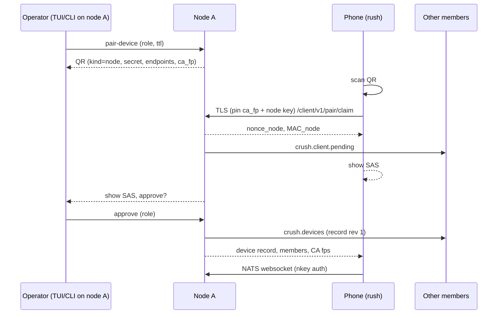

# Mobile Client Pairing — Design

Status: proposal (design only, nothing implemented).

## Overview

This spec adds a **client device** trust class to the Crush cluster so a phone
running [rush](https://github.com/taigrr/rush) (React Native / Expo) can pair
once by QR code and then see and drive every session on every node.

A device pairs with one node, but the resulting device record is replicated to
every member, so the device can authenticate to any node, follow sessions as
they move, and keep working when the node it paired with is offline.
Revoking a device from any node revokes it everywhere.

The design reuses what the cluster already has (see [cluster.md](../cluster.md)):
approval-gated pairing, ID-and-key pinning, the embedded NATS mesh, the
`/v1/nodes/<node-id>/...` proxy, and the wire 2 event stream.

## Goals

- Pair a phone with the whole cluster from a single QR scan, in either
  direction:
  - **(a)** a node shows a QR code, the phone scans it;
  - **(b)** the phone shows a QR code, an operator approves it from any node.
- Every pairing is confirmed by a human on a node, using a short
  authentication string (SAS) shown on both screens.
- Mutual key pinning: the phone pins the cluster, the cluster pins the phone.
- One credential valid on every node; revocation propagates over the mesh.
- A primary transport that works well on mobile networks (NATS over TLS
  websocket) and a plain HTTPS fallback.
- Scoped permissions: a device can be read-only, an operator, or explicitly
  granted more; it never gets node-level powers by default.
- Optional push notifications for attention events that never carry code,
  prompts, or tool input.

## Non-goals

- Phones are **not** cluster members.
  They hold no cluster key, no member certificate, no replicas, and never own
  sessions or run jobs.
  They do not route NATS traffic and never see mesh-internal subjects
  (`crush.creds`, `crush.repl.*`, `crush.swarm.*`, `crush.heartbeat`).
- No credential sync to devices: API keys and OAuth tokens never leave the
  nodes.
- No relay / NAT traversal service in this spec.
  Devices reach nodes over LAN, WireGuard, or Tailscale.
  The typed endpoint list leaves room for a relay later.
- No mDNS discovery in the first phases (see [Rollout](#rollout)).
- No end-to-end encryption between phone and owning node beyond TLS; the
  forwarding node is a cluster member and is trusted like any member.

## Terminology

| Term | Meaning |
| --- | --- |
| Node | A cluster member (`crush server --persistent`). |
| Device | A paired client (phone, tablet). Identified by a device ID and an ed25519 public key. |
| Pairing node | The node that runs the pairing handshake and records the approval. |
| Entry node | The node a device is currently connected to. Any member. |
| Owning node | The node that owns the session a request targets (`sessions.owner_node`). |
| Device registry | The replicated set of device records (`cluster/devices.json`). |
| SAS | Short authentication string: 4 emoji plus 6 digits derived from the handshake transcript. |

## Threat model

| Threat | Mitigation |
| --- | --- |
| **Lost or stolen phone** | The device key lives in the iOS Keychain / Android Keystore, `WhenUnlockedThisDeviceOnly`, never exported or backed up. rush gates the app (and approvals) behind biometrics. Any node revokes the device (`crush cluster devices revoke`); the revocation reaches every member within one heartbeat and open connections are closed. Credentials are short lived (15 min tokens), so an offline node that missed the revocation stops accepting the device when its token expires and it cannot mint a new one without the registry. |
| **Leaked QR / screenshot** (flow a) | The pairing secret is single use, expires after 120 s (configurable, max 10 min), and is bound to one pairing node. Scanning it only creates a *pending* request; a human must approve it on a node after comparing the SAS with the phone. A second claim of the same offer invalidates the offer and is shown as a warning. |
| **Leaked QR / screenshot** (flow b) | The phone's QR contains only its public key, a one-time secret, and metadata. Whoever approves it must also see the matching SAS on the phone. An attacker holding the screenshot cannot complete the handshake without the device private key. |
| **Replay** | Every handshake message carries the offer ID, both nonces, and an expiry, and is MAC'd with a key derived from the pairing secret. Offers are tombstoned after use. Device auth uses a fresh server nonce per connection (NATS `nonce`, HTTPS challenge) signed by the device key; tokens are bound to the device ID and carry `exp`, `iat`, and a key epoch. |
| **Rogue node** (a node that is not a member pretending to be one) | The QR carries the cluster CA fingerprint and the pairing node's public key fingerprint. The phone pins both and refuses any TLS peer whose leaf is not signed by a pinned CA *and* whose node ID/key is not in the member list it received during pairing. A leaked join token lets an attacker *request* to join, not mint a certificate for a pinned node ID, so it cannot impersonate a member to a device that checks the member list. |
| **Compromised member** | Out of scope: members fully control each other already. A device trusts every pinned member equally. |
| **MITM on LAN / Wi-Fi** | TLS 1.3 with the CA pinned from the QR (out of band, camera channel). No trust-on-first-use. Flow (b) uses the SAS to detect a substituted endpoint because the phone has no out-of-band CA fingerprint until it is approved. |
| **Revoked device keeps a live connection** | Each node watches the registry; on revocation it kicks the NATS client (`kick` by client ID), cancels HTTPS streams, and stops forwarding requests stamped with that device ID. Owning nodes also check the registry on every bridged request, so an entry node that is slow to apply the revocation still cannot act on the device's behalf. |
| **Over-privileged device** | Permissions are enforced on the owning node per request against an allow-list of `/v1` routes (see [Permissions](#permissions)). NATS permissions limit the device to its own subjects, so it cannot even address mesh subjects. |
| **Push provider learning content** | Push payloads carry only an opaque, device-encrypted blob or nothing at all (see [Push notifications](#push-notifications)). |
| **Brute-forcing pairing** | Offers are rate-limited per node (5 claims per minute, 3 failed MACs kill the offer). Pending device requests are capped (16) and expire. |

## Identities and keys

### Device

- On first launch rush generates an **ed25519 keypair** (the NATS nkey user
  format, prefix `U`) and keeps the seed in secure storage.
  Hardware-backed P-256 keys are an option for later; ed25519 is chosen now
  because NATS nkeys and the existing cluster code already use it.
- **Device ID** = `dev_` + first 16 bytes of `SHA-256(public key)`,
  base32 lower-case.
  It is derived, so it cannot be chosen by an attacker to collide.
- Display identity: device name (user-editable, e.g. "Tai's iPhone"),
  platform, model, app version, and a deterministic color-animal derived with
  `internal/swarm` from the device ID (so devices look like sessions in the
  UI).

### Cluster, as seen by a device

- **Cluster CA fingerprint**: `SHA-256(CA public key)` for the CA derived from
  the cluster key (`cluster/pki.go`).
  After `rotate-key` there is a new CA; see
  [Key rotation](#key-rotation).
- **Member list**: node ID, name, public key, and endpoints for every member,
  delivered at the end of pairing and refreshed over the authenticated
  channel.
- A node's client-facing TLS certificate is its existing leaf
  certificate (node ID as CN, signed by the cluster CA), so no new PKI is
  required.

## QR payload

One versioned format for both directions:

```
rushpair1:<base64url(CBOR map), no padding>
```

CBOR is used (deterministic encoding, RFC 8949 §4.2) because the same data as
JSON makes the QR code roughly 40% denser.
Integer keys keep it small.
Unknown keys are ignored; an unknown version prefix is rejected with "update
rush / Crush".
The same string is accepted by paste, so it also works over AirDrop,
clipboard, or SSH.

### Kind `node` (flow a, node shows the code)

| Key | Name | Type | Notes |
| --- | --- | --- | --- |
| 0 | `kind` | uint | `1` = node offer. |
| 1 | `cluster_id` | text | |
| 2 | `cluster_name` | text | Optional, for display. |
| 3 | `node_id` | text | Pairing node. |
| 4 | `node_name` | text | |
| 5 | `node_key_fp` | bytes(32) | `SHA-256(node ed25519 public key)`. |
| 6 | `ca_fp` | bytes(32) | Current cluster CA fingerprint. |
| 7 | `endpoints` | array | `[{k: kind, a: addr}]` where kind is `lan`, `wg`, `ts`, `direct`, and addr is `host:port` of the client listener. |
| 8 | `offer_id` | bytes(16) | Random; identifies the offer. |
| 9 | `secret` | bytes(32) | Single-use pairing secret. |
| 10 | `expires` | uint | Unix seconds. |
| 11 | `scopes` | array | Requested role/scopes preset by the operator (display only; the approval is authoritative). |
| 12 | `proto` | uint | Client protocol version (`1`). |

### Kind `device` (flow b, phone shows the code)

| Key | Name | Type | Notes |
| --- | --- | --- | --- |
| 0 | `kind` | uint | `2` = device request. |
| 1 | `device_pub` | bytes(32) | ed25519 public key. |
| 2 | `device_name` | text | |
| 3 | `platform` | text | `ios`, `android`. |
| 4 | `offer_id` | bytes(16) | |
| 5 | `secret` | bytes(32) | Single-use, generated by the phone. |
| 6 | `expires` | uint | Unix seconds, default now + 10 min. |
| 12 | `proto` | uint | |

A device code is also rendered as a short **typed code** for when no camera or
clipboard is available: the first 10 bytes of `SHA-256(payload)` as
`XXXXX-XXXXX-XXXXX-XXXXX` (Crockford base32).
That code alone is not enough to pair; it only lets the operator select which
pending request (created when the phone connects) to approve.

## Pairing flows

Both flows use the same handshake; they differ in who generates the secret and
how the phone learns where the cluster is.

### Handshake (common)

Let `S` be the pairing secret and `T` the transcript:

```
T = "rushpair1" || offer_id || cluster_id || node_id || node_pub
    || device_pub || nonce_node || nonce_device
K = HKDF-SHA256(ikm = S, salt = offer_id, info = "rush pair v1")
MAC_x = HMAC-SHA256(K, label_x || T)
SAS  = HKDF-SHA256(ikm = S, salt = T, info = "rush sas v1")[0:5]
       -> 4 emoji (index into a fixed 64-entry table, 6 bits each)
          + 6 digits (remaining bits mod 10^6)
```

1. Phone opens TLS to a client endpoint of the pairing node.
   In flow (a) it verifies the leaf against `ca_fp` and that the CN is
   `node_id` with a key hashing to `node_key_fp`; anything else aborts.
2. Phone sends `POST /client/v1/pair/claim` with `offer_id`, `device_pub`,
   device metadata, `nonce_device`, and `MAC_claim`, and signs the body with
   the device key (proof of possession).
3. Node checks the offer is live and unused, verifies MAC and signature,
   marks the offer *claimed* (single use), and answers with `nonce_node`,
   `node_pub`, the member list, and `MAC_node`.
4. Both sides display the SAS.
   The node raises a **pending device** request on every attached TUI of every
   node (`crush.client.pending`, mesh-internal) and in
   `crush cluster devices pending`.
5. The operator compares the SAS and approves on **any** node, choosing a role
   (default `operator`, see [Permissions](#permissions)).
   The phone also asks the user to confirm the SAS matches; a "doesn't match"
   tap aborts and reports the offer as compromised.
6. The approving node writes the device record, broadcasts it, and the
   pairing node returns `200` on the phone's long-poll
   (`GET /client/v1/pair/{offer_id}`, authenticated by `MAC`) with the
   final device record, the cluster CA fingerprint(s), and the member list.
7. The phone pins the CA fingerprint(s), the member list, and connects to the
   NATS websocket with its nkey.

Approval is required even in flow (a) — the QR is a capability to *ask*, the
same rule as join tokens.
An operator can pre-approve when creating the offer
(`crush cluster pair-device --approve`), in which case step 5 is skipped but
the SAS is still shown on both screens for a visual check.
Pre-approved offers default to a 60 s lifetime.

### Flow (a): node shows QR



Surfaces:

- **CLI**: `crush cluster pair-device [--name hint] [--role operator]
  [--scopes ...] [--ttl 2m] [--approve] [--endpoint kind=addr ...]`
  renders the QR in the terminal (half-block characters) and the payload
  string, then waits for the claim, prints the SAS, and prompts for approval.
- **TUI**: command palette `Pair Mobile Device` opens a dialog with the QR,
  a countdown, and, once claimed, the device name, SAS, role picker, and
  Approve / Deny.

### Flow (b): phone shows QR

Used when the node cannot be scanned (headless daemon over SSH, no terminal
QR rendering) or when the operator prefers to approve from the machine in
front of them.

1. rush shows a `kind=device` QR, the payload string (share sheet), and the
   typed code.
2. The operator runs `crush cluster devices add <payload>` (or pastes it in
   the TUI `Add Mobile Device` dialog).
   That node creates a **device offer** keyed by `offer_id`, holding
   `device_pub` and `secret`, and replicates it to every member over the mesh
   (`crush.devices.offer`), so the phone may connect to any node.
   The command prints the node QR (kind `node`, *without* a secret) and its
   endpoints, so a phone that can scan learns the CA fingerprint the easy way.
3. The phone needs an address: it either scans that node QR, or the user
   enters a host (`laptop.tailnet.ts.net`, a WireGuard IP, a LAN IP).
4. Without a scanned `ca_fp` the phone cannot pin the CA in advance, so it
   connects, records the presented CA fingerprint, and runs the handshake;
   the node proves knowledge of `S` via `MAC_node`, which a MITM does not
   have because `S` only travelled phone → operator through the camera or
   clipboard.
   The SAS then confirms both ends saw the same transcript, including the CA.
5. Approval and completion are as in the common handshake.
   The node that ran `devices add` counts as the approval if the operator
   chose `--approve`; otherwise any node can approve after comparing the SAS.

An already paired device with the `devices:approve` scope can also scan
another phone's `kind=device` QR and submit it, which is how a second phone
is added from the first without a terminal.

### Abort and expiry

- Offers expire at `expires`; pending device requests expire 10 minutes after
  their claim.
- A deny, a SAS mismatch report, or three bad MACs tombstones the offer on
  every node.
- Expired offers and pending requests are pruned at startup and every minute.

## Device registry (full-cluster validity)

### Record

```json
{
  "device_id": "dev_k3x9...",
  "name": "Tai's iPhone",
  "platform": "ios",
  "model": "iPhone16,2",
  "app_version": "0.3.0",
  "public_key": "<base64 ed25519>",
  "role": "operator",
  "scopes": ["sessions:read", "sessions:prompt", "permissions:answer"],
  "paired_at": "2026-02-11T10:00:00Z",
  "paired_via": "<node id>",
  "approved_by": "<node id>",
  "rev": 3,
  "updated_at": "2026-02-11T10:05:00Z",
  "updated_by": "<node id>",
  "revoked_at": null,
  "push": { "relay": "self", "token_ciphertext": "<...>" }
}
```

Last-seen data (node, address, time) is kept per node in memory and
in heartbeats, not in the replicated record, to avoid write amplification.

### Storage

- `<global data dir>/cluster/devices.json` (0600), next to `cluster.json`.
  A separate file keeps `cluster.json` readable by older releases and makes
  membership writes and device writes independent.
- Shape: `{ "version": 1, "devices": [...], "offers": [...], "tombstones": [...] }`.
- No SQLite migration: device state is cluster state, not workspace state,
  and must exist on nodes with no open workspace.
  A small `client_audit` table may be added later in the global DB if audit
  history beyond logs is wanted (open question).

### Replication

Modelled on `credsync` but per record rather than whole file:

- Subject `crush.devices` (mesh-internal, member-only): a node that changes a
  record publishes the full record.
- Merge rule per `device_id`: higher `rev` wins; equal `rev` → later
  `updated_at`, then lower `updated_by` node ID.
  **A revoked record always wins** over a non-revoked one regardless of
  `rev`, and revocation is permanent (re-pairing creates a new key, therefore a
  new device ID).
- Subject `crush.devices.request`: on start, join, or reconnect a node asks
  every peer to announce its registry digest
  (`SHA-256` of sorted `device_id:rev:revoked`); peers with a different digest
  send their records.
  This is the same "ask everyone to announce" convergence `credsync` uses.
- A node that joins the cluster receives the registry as part of the join
  response members payload as well, so it can authenticate devices before the
  mesh is up.
- Offers (`crush.devices.offer`) replicate the same way but are ephemeral and
  never written for `kind=node` secrets: a node offer's secret stays on the
  node that created it, so only flow (b) offers are replicated.

### Authentication on any node

Each node authenticates devices locally from its registry copy, so there is no
dependency on the pairing node being online.
The device record's `public_key` is the credential; nothing secret is shared
with the cluster.

## Key rotation

`crush cluster rotate-key` changes the cluster key and therefore the derived
CA, which would break the phone's CA pin.

- A device pins a **set** of CA fingerprints (current and previous), mirroring
  `State.Key` / `State.PrevKey`.
- After a rotation each node publishes `crush.client.trust` to every
  connected device: `{ca_fps: [new, prev], key_version}`, signed by the
  node's ed25519 key, over the already authenticated TLS session.
  The device accepts it only from a pinned member, and only adds; the previous
  fingerprint is dropped once a second rotation occurs.
- A device that was offline across two rotations can no longer verify any
  node: it shows "re-pair required".
  (Alternatively nodes could keep a chain of signed CA transitions; see
  [Open questions](#open-questions).)
- Device credentials themselves are unaffected by rotation: devices are pinned
  by their own key, not by the cluster key.
- `crush cluster leave` on a node closes its device connections; devices drop
  that node from their member list on the next `crush.client.members` update.
- Member list changes (join, leave, rename, new endpoints) are pushed on
  `crush.client.members`, signed like `trust`.

## Transport

### Client listener

A new TLS listener per node, default `:7733` (`--client-addr`, off unless the
node has at least one device or an open offer, or `cluster.clients.enabled`
is set).
It is separate from the member listener (`:7731`) because that one requires
member client certificates, and from the mesh route port (`:7732`).

One port serves two things, selected by path:

- `GET /nats` → NATS websocket (`nats-server` websocket listener behind a
  path handler, TLS terminated by Crush with the node's leaf certificate).
- `/client/v1/...` → HTTPS: pairing endpoints and the HTTP fallback API.

Certificates: the node's existing leaf; SANs gain every advertised client
endpoint host so standard hostname verification also passes for clients that
want it, but rush verifies by CA pin + node ID, not hostname.

### NATS isolation

Devices connect to the embedded server in a separate **`CLIENTS` account**.
The mesh account (where `crush.creds`, `crush.repl.*`, `crush.swarm.*` live)
is never visible to it.
Crush's in-process connection bridges between the accounts explicitly, so no
mesh subject can leak through a permission mistake.

Authentication uses **auth callout** (nats-server ≥ 2.10) rather than
operator/JWT mode, because the cluster has no operator and the registry is
already replicated:

1. The device connects with its nkey; the server sends a nonce.
2. The callout handler (in-process) verifies the nonce signature against the
   registry, rejects revoked or unknown keys, and issues a user JWT for the
   `CLIENTS` account with:
   - `name` = device ID;
   - publish allow: `crush.client.v1.<device_id>.>`;
   - subscribe allow: `crush.client.v1.<device_id>.>`,
     `crush.client.v1.broadcast.>`, `_INBOX.<device_id>.>`;
   - deny everything else; no `$SYS`, no JetStream API;
   - `exp` = 15 minutes; the client reconnects transparently (re-auth) on
     expiry, which re-checks the registry.
3. The device uses a custom inbox prefix `_INBOX.<device_id>` so replies are
   private.

On revocation the node kicks the client by its connection ID.

Leaf/route behaviour: client connections are local to their entry node.
The entry node forwards to other nodes over the existing mesh, so devices
never need routes to other members.

### Subject namespace

All under `crush.client.v1`; `<dev>` is the device ID, `<node>` a node ID.

| Subject | Direction | Purpose |
| --- | --- | --- |
| `crush.client.v1.<dev>.api.<node>` | device → node (req/reply) | Bridged `/v1` request executed on `<node>` (see below). `<node>` = `any` lets the entry node route by session owner. |
| `crush.client.v1.<dev>.sub` | device → node (req/reply) | Open an event subscription (workspace events, global events). Returns a stream ID. |
| `crush.client.v1.<dev>.ev.<stream>` | node → device | Event frames for that stream (wire 2, framed). |
| `crush.client.v1.<dev>.ack.<stream>` | device → node | Flow control: highest sequence consumed, credit. |
| `crush.client.v1.<dev>.unsub` | device → node | Close a stream. |
| `crush.client.v1.broadcast.attention` | node → devices | Fan-out of `crush.attention` (permission, question, busy, idle), filtered by device scopes, stripped of tool input. |
| `crush.client.v1.broadcast.nodes` | node → devices | Heartbeat summary for the cluster view (online, RTT, CPU/mem/disk, jobs). Rate-limited to one per 5 s. |
| `crush.client.v1.<dev>.trust` | node → device | CA fingerprint updates. |
| `crush.client.v1.<dev>.members` | node → device | Member list updates. |
| `crush.client.v1.<dev>.control` | node → device | `revoked`, `scopes_changed`, `reauth`. |

Mesh-internal additions (members only, never in `CLIENTS`):
`crush.devices`, `crush.devices.request`, `crush.devices.offer`,
`crush.client.pending`, `crush.client.fwd.<node>` (entry → owning node
forwarding, carries the authenticated device ID stamped by the entry node).

### NATS-to-HTTP bridge

A request on `...api.<node>` is a CBOR (or JSON, by header) envelope:

```json
{
  "id": "01J...",
  "method": "POST",
  "path": "/v1/workspaces/{id}/permissions/grant",
  "query": "",
  "headers": { "content-type": "application/json" },
  "body": "<bytes>"
}
```

1. The entry node checks the route against the device's scopes (fast reject).
2. If `<node>` is itself, or the target session/workspace is local, it
   dispatches the request to the in-process `/v1` handler with a request
   context carrying `device_id` and scopes.
   Otherwise it forwards on `crush.client.fwd.<node>` with the stamped device
   ID; the owning node **re-checks** the registry and scopes before
   dispatching.
   Untrusted device-supplied identity headers are stripped, like swarm sender
   identity today.
3. The response (status, headers, body) returns on the reply inbox.
   Bodies over 512 KiB are chunked on `...ev.<stream>` with a stream ID instead.

The bridge reuses the same handler the `/v1/nodes/<node-id>/...` proxy
reaches (`/node/v1/api/*`), so there is one API surface and one swagger.

### Event streams

`...sub` requests take the same parameters as the SSE endpoints
(`/v1/events`, `/v1/workspaces/{id}/events`) and always use `wire=2` with
`frame_ms` (default 100 ms on mobile).
The owning node runs the SSE producer internally and publishes each frame on
`...ev.<stream>` with a per-stream `seq`.

- The device acks every N frames; the node pauses a stream with more than 256
  unacked frames and sends a full `resync` frame when credit returns, which
  wire 2 clients already handle (they drop deltas whose prior length does not
  match and wait for the next full message).
- Streams are leased: no ack for 60 s closes them.
- Gap detection by `seq`; on a gap the device resubscribes and receives
  current state first.
- Payloads above 1 KiB are gzipped per frame (`enc: gzip`).

### HTTPS fallback

For networks that block websockets or for simple tooling:

- `POST /client/v1/auth/challenge` → `{nonce}`;
  `POST /client/v1/auth/token` with `{device_id, nonce, sig}` → a bearer
  token: a compact signed token (`v1.<payload>.<sig>`, ed25519 by the issuing
  node) with `sub` = device ID, `iss` = node ID, `scp`, `iat`, `exp` = 15 min,
  `kv` = registry rev at issue.
  Any member verifies it with the issuer's pinned public key and re-checks
  the registry, so tokens work across nodes.
- `/client/v1/api/<path>` mirrors `/v1/<path>` for the local node and
  `/client/v1/api/nodes/<node-id>/<path>` mirrors the existing
  `/v1/nodes/<node-id>/<path>` proxy for other nodes.
- SSE endpoints work as today (`wire=2`, `frame_ms`, gzip).

### Reachability

- Endpoints in the QR and member list are typed: `lan`, `wg` (WireGuard),
  `ts` (Tailscale, IP or MagicDNS name), `direct` (manual /
  `--advertise`).
  This extends the existing `EndpointKind`; old members ignore unknown kinds.
- The phone tries endpoints of all members in parallel (happy eyeballs, 250 ms
  stagger), preferring the last successful one, and keeps one connection to
  one entry node at a time.
- `--client-advertise` overrides auto-detected endpoints, like
  `--advertise` for members.
- mDNS (`_crush-client._tcp`) is a later phase and only ever provides
  *addresses*; trust always comes from pins.

## Permissions

Devices get a **role** plus optional extra **scopes**.
The role is chosen at approval and editable later from any node.

| Scope | Allows | viewer | operator | admin |
| --- | --- | :-: | :-: | :-: |
| `sessions:read` | List workspaces, overviews, sessions, messages, history, events, diffs, milestones, swarm resolve, node dashboard. | yes | yes | yes |
| `sessions:prompt` | Send prompts (queue / btw), cancel turns and tools, goal, title, summarize, mark seen/favorite/archive, create sessions in existing workspaces. | | yes | yes |
| `permissions:answer` | Grant or deny tool permissions once or for the session; answer questions. | | yes | yes |
| `permissions:always` | Persistent "always allow" grants and `yolo` / auto-approve policy changes. | | | yes |
| `config:model` | Switch model/provider for a session. | | yes | yes |
| `sessions:move` | Move sessions, migrate, autobalance. | | | yes |
| `shell` | `.../shell` (run arbitrary commands). | | | opt-in |
| `devices:approve` | Approve/deny/revoke other devices, change their roles (never above its own). | | | yes |
| `cluster:approve` | Approve or deny **node** join requests. | | | opt-in |

Rules:

- **Never** available to devices, any role: provider keys and OAuth
  (`config/provider-key`, `refresh-oauth`, `import-copilot`, `config/set`,
  `config/remove`), cluster key ops (`token`, `rotate-key`, `leave`,
  `upgrade`), `debug` endpoints, replication and transfer endpoints, the
  member API.
- `cluster:approve` and `shell` are **opt-in** even for `admin`: an operator
  must name them explicitly
  (`crush cluster devices scopes <dev> +cluster:approve`), and the CLI warns.
  Default: a phone cannot approve new nodes.
- Every route in `swagger.yaml` gets an `x-crush-scope` extension; routes
  without one are denied to devices (default deny), and a unit test fails if a
  route lacks the annotation.
- Device-originated actions carry `device_id` in their context; permission
  grants, prompts, and session creation record it (message metadata
  `origin: device:<id>`), and the TUI shows "via Tai's iPhone".
- Turns started by a device run with the session's existing permission
  policy; a device cannot escalate the policy without `permissions:always`.
- rush requires biometrics for `permissions:answer` actions by default
  (client-side, defense in depth).

## Push notifications

Attention events (`permission`, `question`, `idle` after a long run, run
failed) can wake the phone.

Options, chosen per cluster in `crush.json` (`cluster.clients.push`):

1. **`none`** (default): no push. rush relies on its live connection while
   foregrounded and on background fetch (best effort, OS-throttled).
2. **`self`**: a self-hosted relay (`crush push-relay`, a small binary or any
   node with the APNs `.p8` key / FCM service account) sends pushes.
   Credentials for APNs/FCM live only on the relay node.
   rush builds for self-hosted relays require the user's own bundle ID /
   Firebase project, which is the price of no third party.
3. **`expo`**: the Expo push service (or a Charm/Tai-run relay) for the
   official rush build.
   The service sees device push tokens and timing, never content.

Privacy rules, all modes:

- Payload: `{v:1, d:<device_id>, n:<random notification id>, c:<ciphertext>}`
  where `c` is encrypted to a per-device push key (X25519 + ChaCha20-Poly1305,
  key exchanged at pairing).
  The iOS Notification Service Extension / Android service decrypts it
  locally to render "@laptop · coral-otter needs permission: bash".
- The ciphertext contains only kind, session color-animal, node name,
  workspace basename, and the tool name — never prompts, code, commands, tool
  input, file paths beyond the basename, or model output.
  A per-device setting can reduce it to "Crush needs you".
- Exactly one node sends a given notification: the owning node of the session
  (it is the one that produced the event), deduplicated by event ID.
- Actionable notifications (Allow / Deny) post back over HTTPS with a
  one-shot action token embedded in the encrypted payload, scoped to that
  permission request ID and valid 10 minutes, so the app does not need a full
  NATS session to answer from the lock screen.
- Push tokens are stored encrypted to the relay's key in the device record
  (`push.token_ciphertext`), so other nodes replicate but cannot read them.

## Surfaces to add

### CLI

| Command | Purpose |
| --- | --- |
| `crush cluster pair-device` | Flow (a): show a QR + payload, wait, show SAS, approve (`--role`, `--scopes`, `--ttl`, `--approve`, `--endpoint`, `--no-qr`). |
| `crush cluster devices` | List devices (name, ID, role, last seen, entry node, revoked). |
| `crush cluster devices add <payload\|->` | Flow (b): register a phone's `kind=device` payload (`--approve`, `--role`). |
| `crush cluster devices pending` | Pending device requests with SAS. |
| `crush cluster devices approve <id\|code>` / `deny` | Decide a pending request (`--role`, `--scopes`). |
| `crush cluster devices revoke <id\|name>` | Revoke everywhere; closes live connections. |
| `crush cluster devices role <id> <viewer\|operator\|admin>` | Change role. |
| `crush cluster devices scopes <id> [+scope] [-scope]` | Adjust scopes. |
| `crush cluster devices rename <id> <name>` | Rename. |
| `crush push-relay` | Optional self-hosted push relay (phase 5). |

`crush cluster status` gains a devices section, and `crush cluster top` a
"devices online" count.

### TUI

- Palette: `Pair Mobile Device` (QR dialog, flow a), `Add Mobile Device`
  (paste payload, flow b), `Mobile Devices` (list with revoke / role).
- A pending-device prompt like the join prompt, shown on every attached TUI of
  every node, with the SAS in large emoji.
- "via <device>" badge on messages and permission decisions made from a
  device.
- New keybindings, if any, go into `FullHelp()` in
  `internal/ui/model/ui.go`.

### Local API (`/v1`, swagger)

For the TUI and CLI (local socket only, never exposed to devices unless noted):

| Method & path | Purpose |
| --- | --- |
| `POST /v1/cluster/devices/offers` | Create a node offer; returns payload, QR matrix, expiry. |
| `GET /v1/cluster/devices/offers/{id}` | Offer state (open, claimed + SAS, approved, expired). |
| `DELETE /v1/cluster/devices/offers/{id}` | Cancel. |
| `POST /v1/cluster/devices/requests` | Flow (b): submit a device payload. |
| `GET /v1/cluster/devices` | List records. Device-visible with `devices:approve` (minus push fields). |
| `GET /v1/cluster/devices/pending` | Pending requests. |
| `POST /v1/cluster/devices/{id}/approve` / `deny` | Decide. Device-visible with `devices:approve`. |
| `POST /v1/cluster/devices/{id}/revoke` | Revoke. Device-visible with `devices:approve`. |
| `PATCH /v1/cluster/devices/{id}` | Name, role, scopes. |
| `GET /v1/client/self` | For devices: own record, scopes, entry node. |

Client listener (`/client/v1`, devices only): `pair/claim`,
`pair/{offer_id}`, `auth/challenge`, `auth/token`, `push/register`,
`push/action`, `api/...`, `api/nodes/{node_id}/...`.
These are documented in the same `swagger.yaml` under a `client` tag so rush
can generate its client from it.
New error codes (`device_revoked`, `device_scope_denied`,
`pair_offer_expired`, `pair_offer_used`, `pair_mac_invalid`) are defined as
swagger enums, not string literals.

### Config (`crush.json`)

```json
{
  "cluster": {
    "clients": {
      "enabled": true,
      "addr": ":7733",
      "advertise": ["ts=laptop.tailnet.ts.net:7733"],
      "offer_ttl": "2m",
      "default_role": "operator",
      "push": { "mode": "none" }
    }
  }
}
```

Per the project rule, the `crush-config` builtin skill is updated alongside.

## Versioning

- `proto.ProtocolVersion` stays for the `/v1` API; a separate
  `ClientProtocolVersion = 1` is advertised by the client listener
  (`GET /client/v1/info`) and in the QR (`proto`).
  rush refuses a cluster whose client protocol is newer than it supports and
  asks to update; nodes refuse older device protocols with an upgrade hint.
- Device support does **not** bump the member protocol: members that predate
  it ignore `crush.devices*` subjects.
  But mixed clusters are only partially valid for devices (old members cannot
  authenticate them), so `crush cluster status` warns and the member list
  sent to devices marks such nodes `devices: unsupported`; rush will not use
  them as entry nodes.
  Since nodes on different releases already refuse jobs, the expected state
  is a homogeneous cluster after `crush cluster upgrade`.
- The `rushpair1:` prefix and `devices.json` `version` field are bumped only
  on incompatible changes.

## Rollout

1. **Registry and pairing over HTTPS.**
   `devices.json`, replication (`crush.devices*`), client listener with
   `/client/v1/pair/*` and `auth/*`, flows (a) and (b), CLI commands, TUI
   dialogs, scope annotations on swagger with default deny, HTTPS fallback API
   with bearer tokens.
   rush works end to end over HTTPS + SSE.
2. **NATS websocket.**
   `CLIENTS` account, auth callout, subject namespace, NATS-to-HTTP bridge,
   event streams with flow control, attention and node fan-out.
   rush switches its primary transport.
3. **Rotation and membership updates.**
   `crush.client.trust` / `members`, CA fingerprint sets, re-pair UX.
4. **Device admin from devices.**
   `devices:approve`, phone-to-phone pairing, opt-in `cluster:approve`.
5. **Push.**
   Encrypted payloads, `self` relay, then `expo` mode, actionable
   notifications.
6. **Discovery.**
   mDNS addresses on LAN.

## Testing plan

- **Unit**
  - QR payload CBOR round-trip, deterministic encoding, version rejection,
    size budget (node payload ≤ 400 bytes so the QR stays at version ≤ 15
    with medium ECC).
  - Handshake: MAC/SAS test vectors shared with rush (a JSON fixture under
    `internal/cluster/testdata/pairing/` that the rush repo vendors).
  - Offer single use, expiry, rate limit, three-strikes.
  - Registry merge: rev ordering, tie-breaks, revoke-wins, digest
    convergence.
  - Scope table: every swagger route has `x-crush-scope`; never-list routes
    are denied for every role.
  - Bearer token verification across issuers; revoked device rejected even
    with a valid token.
  - Auth callout: unknown key, revoked key, permission set contents.
- **Integration (`internal/server`, in-process)**
  - Two nodes in one process (like the existing mesh tests): pair on A,
    authenticate on B, bridge a prompt to a session owned by B through A,
    revoke on B and observe A kick the connection.
  - Event stream: wire 2 frames over NATS, pause/resume under credit
    exhaustion, resync after gap.
  - Mesh subjects unreachable from a device connection (publish/subscribe
    attempts to `crush.creds`, `crush.repl.changed` fail).
- **Cluster harness (`test/cluster`, `task test:cluster`)**
  - Add a `device` container running a Go test client (no phone needed) that
    implements the rush side of the protocol from the shared fixtures.
  - Scenario: node A creates an offer (`pair-device --approve --no-qr`), the
    device claims it, connects to node B, lists sessions on both nodes,
    answers a permission on a session owned by B, follows a session move
    A → B without re-pairing, then is revoked from A and must fail on B
    within one heartbeat.
  - Flow (b) scenario: device prints a `kind=device` payload, node B runs
    `devices add --approve`, device connects to A.
  - Rotation scenario: `rotate-key` while the device is connected; device
    reconnects to the other node with the new CA pin.
- **rush side**
  - Contract tests against the swagger client tag and the fixture vectors;
    an Expo dev build against the harness for manual QA.

## Open questions

1. **CA chain vs re-pair.**
   Should nodes keep a signed chain of CA transitions so a device offline
   across several rotations can catch up, or is "re-pair" acceptable?
2. **Separate client CA.**
   Deriving client TLS from the cluster key couples device pins to
   `rotate-key`.
   A dedicated, rarely rotated "client CA" (stored in `cluster.json`,
   replicated to members) would decouple them at the cost of new PKI.
3. **Hardware keys.**
   Move device keys to Secure Enclave / StrongBox P-256 and add a P-256
   user-auth path to the callout (NATS nkeys are ed25519 only)?
4. **Audit log.**
   Is `slog` enough, or do we want a replicated, append-only device audit
   (approvals, revocations, permission answers) in the global DB?
5. **Relay for off-network access.**
   Tailscale covers most cases; is a Crush-run relay endpoint kind worth
   specifying now?
6. **Device-created workspaces.**
   Should `sessions:prompt` allow opening a new workspace path on a node
   (`crush run --balance` equivalent), or only sessions in existing
   workspaces?
7. **Multiple clusters.**
   rush can hold several pairings; does Crush need anything beyond distinct
   cluster IDs (e.g. a cluster display name in `cluster.json`)?
8. **Push sender election.**
   If the owning node is offline (session shown from a replica), nothing can
   fire for it anyway — confirm no other node should send on its behalf.
